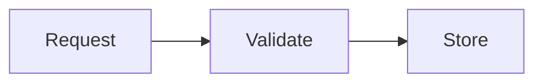

# Ground reality: HTML, Markdown, and an AI-oriented extension

Research checked on **8 November 2026**. This document separates observed evidence, engineering analysis, and a proposed direction. It is a focused source review, not a systematic literature review, adoption survey, security audit, or measured model benchmark.

## Finding

There is evidence of a recent push toward rich HTML explanations. There is also a practical opportunity to produce similar document features from compact, structured Markdown. The evidence does **not** establish that Markdown is inherently unpleasant to read, that Claude universally replaced it, or that any new extension will automatically be faster, cheaper, or safer.

The useful problem statement is:

> How can an AI describe prose, visual relationships, and a limited set of interactions with little presentation code, while readers receive a consistent, accessible document?

## 1. What the recent trend actually establishes

On 8 May 2026, Simon Willison discussed **“Using Claude Code: The Unreasonable Effectiveness of HTML”**, attributing the argument to Thariq Shihipar of Anthropic's Claude Code team. Willison said the piece caused him to reconsider his default of requesting Markdown, especially for output. His explanation of the appeal was SVG diagrams, interactive widgets, navigation, and other ways of making information pleasant to navigate. [S1]

Shihipar's companion gallery contains twenty self-contained HTML examples: annotated reviews, comparisons, implementation plans, diagrams, explainers, reports, slide decks, and editing interfaces. This is direct evidence of the proposed workflow and its capabilities. It is a curated demonstration, not evidence of a general readability improvement or widespread adoption. [S2]

Current Claude documentation describes artifacts as designs, decks, documents, dashboards, and small interactive tools. It still explicitly describes editing Markdown documents and exporting Docs to Markdown. This does not support the stronger claim that Claude has abandoned Markdown. The current product documentation is broader than the May article's single-file HTML workflow. [S3]

**Verdict:** The observed enthusiasm is real. Calling it a universal replacement or a proven “bubble” goes beyond this evidence. No quantitative adoption estimate follows from the sources reviewed.

## 2. Separate source syntax from the reading experience

Markdown is a source language. HTML describes document structure and is also a browser rendering target. CSS determines much of the visual presentation; JavaScript supplies many interactions; SVG or canvas supplies graphics.

A Markdown document can become semantic HTML with the same fonts, spacing, line lengths, contrast, navigation, and responsive layout as an HTML-authored document. Markdown's source does not force poor typography. A long, badly organized explanation also stays hard to read when wrapped in attractive HTML.

Basic CommonMark is limited in how it expresses structured layouts and graphics. Extensions and renderers already bridge this gap. GitHub documents Mermaid, GeoJSON, TopoJSON, and ASCII STL rendering inside Markdown fences. Mermaid rendering is a GitHub platform capability, not a feature required by the CommonMark specification. [S4, S5]

The unfair comparison is a plain Markdown display against a hand-designed HTML application. A useful comparison holds content and intended capabilities constant and includes a professionally styled Markdown renderer.

## 3. HTML's practical tradeoffs for generated documents

| Issue | Mechanism | Qualification |
| --- | --- | --- |
| Generation overhead | Repeated tags, attributes, CSS, SVG coordinates, and event code add output beyond the actual explanation. | Minimal HTML can be compact. Shared CSS and components can remove much of the overhead. |
| Completion latency | Longer output usually takes longer to finish, with additional time possible for design, tool calls, and repairs. | No universal multiplier follows. Model, serving conditions, caching, output length, and repair attempts matter. |
| Security surface | Untrusted markup, event handlers, scripts, URLs, CSS resource loads, and SVG can cross into active browser behavior. | Risk depends on capabilities, origin isolation, sanitization, and host configuration. HTML is not intrinsically unsafe to display. |
| More implementation work per answer | The model must make responsive layout, typography, behavior, and content decisions. | Reusable components and design systems help HTML here too. |
| Verification difficulty | A syntactically valid page can have clipped labels, broken controls, inaccessible focus order, or misleading charts. | A declarative renderer can have these bugs as well; it centralizes the work rather than eliminating it. |
| Editing and review | Presentation changes can obscure a small content change in diffs. | Semantic HTML and disciplined templating can remain maintainable. |
| Portability | Custom interactions, layout, and dependencies do not necessarily survive copying into a chat, email, terminal, or document export. | A self-contained HTML page is highly portable across browsers and has real sharing advantages. |
| Consistency | Independently generated styles can vary in accessibility, appearance, and interaction conventions. | A host-controlled theme can make either source format consistent. |
| Runtime weight | Large graphics or scripts can consume CPU and memory or require network access. | Runtime bundle size is separate from model token count. A small source extension can still require a large runtime. |

HTML also has significant strengths: ubiquitous browser support, semantic elements, powerful CSS, accessible native controls when used properly, mature tooling, rich interaction, and a broad graphics ecosystem. It remains appropriate for actual UI prototypes and custom applications.

### Token and latency claims need measurement

Do not publish an assumed ratio such as “HTML uses five times the tokens.” Token counts depend on the exact source and the model tokenizer. Character counts are not token counts. A short unfamiliar DSL can tokenize poorly and require extra instructions or correction turns.

Count the whole generation workflow: grammar instructions, examples, output, corrections, and repeated context. Separately report cached versus uncached instructions where the provider exposes them. Do not count the renderer's installed source as model output unless the model actually generates it.

Likewise, browser parsing and rendering time should be measured separately from model generation. Generating HTML directly can skip a conversion step, while a complicated Markdown graphics renderer can spend substantial time on layout.

The hypothesis worth testing is that reusable visual components reduce total generation work **for document tasks that fit those components**. That is not a claim about all HTML.

## 4. Safety is an architecture property

CommonMark includes raw HTML blocks and inline HTML. A conforming Markdown parser is not an HTML sanitizer. Merely changing the file extension does not remove XSS, malicious URLs, resource loads, or unsafe plugins. [S4]

OWASP recommends safe output APIs, context-appropriate escaping, URL validation, and maintained sanitization when authored HTML must be accepted. It specifically warns that later mutation can invalidate sanitization, and that CSP should be an additional defense rather than the only defense. [S6]

There are three separate concerns:

1. **Rendering attacks:** content reaches executable or unsafe browser contexts.
2. **Resource attacks:** oversized inputs, excessive layout complexity, or pathological parsing consume memory or time.
3. **Prompt injection:** document content tries to instruct an AI that subsequently reads it. Any text format can carry such instructions; a safe renderer does not solve this.

A proposed untrusted-document profile should:

- Escape or reject raw HTML and arbitrary SVG rather than passing them through. Document this deliberate rendering difference from unrestricted CommonMark.
- Accept only registered visual block types and typed attributes. Keep arbitrary JavaScript, imports, event-handler source, author CSS, and arbitrary expressions outside the profile.
- Generate semantic HTML/SVG from validated nodes through fixed templates and safe text APIs. A JSON parse alone is not validation or sanitization.
- Validate links and images separately. Block unsafe URL schemes. Disable automatic external resource loads by default; use explicit host policies for permitted assets and destinations.
- Keep trusted renderer JavaScript separate from document data. Prebuilt tabs, disclosure panels, and chart selection can be interactive without author-supplied programs.
- Enforce byte, nesting, node, edge, row, numeric-range, render-time, and output-size limits. Isolate expensive work where cancellation is feasible.
- Prevent document-level configuration from weakening host security. Do not blindly forward diagram frontmatter or directives to a dependency.
- Pin and maintain dependencies, apply SVG output controls where needed, and add CSP and appropriate origin isolation as further layers.
- Treat server-side asset resolution as a separate boundary: document data must not trigger arbitrary network requests or file reads.

Mermaid itself documents different trust modes. Its default `strict` mode encodes HTML in labels and disables click functionality; `loose` allows both. It also has host-only security configuration keys and limits for text and edges. These are useful controls, not a guarantee that any Mermaid integration is safe. [S7]

## 5. Prior art substantially overlaps the idea

| Project | Existing capability | Implication for XMarkdown |
| --- | --- | --- |
| CommonMark and GitHub rendering | Established prose syntax; GitHub adds diagram rendering through code fences. | Preserve familiar prose and existing diagram conventions. [S4, S5] |
| MyST | Structured Markdown, citations, cross-references, diagrams, interactive figures, an AST, and multiple export targets. | The broad combination of Markdown, graphics, and a parser already exists. Evaluate it before inventing equivalents. Execution-backed features need a separate trust decision. [S8] |
| Markdoc | CommonMark-based syntax with custom tags, attributes, schemas, variables, functions, and validation. | A strong baseline for registered document components. Host functions and components still need capability limits. [S9] |
| MDX | Markdown plus JSX, imported components, and JavaScript compilation. | Strong for trusted application content; ordinary unrestricted MDX is not the proposed untrusted-document format. [S10] |
| Mermaid | Text descriptions compiled into many kinds of diagrams. | Reuse diagram layout rather than making the model emit coordinates. [S7] |
| Vega-Lite | Declarative JSON describing data-to-visual encodings, with axes, scales, legends, composition, and interaction supplied by the compiler. | A strong charts baseline. A restricted wrapper must still constrain URLs, expressions, transforms, and resource use. [S11] |
| unified / remark / micromark | Parsing into syntax trees, transformations, rendering, GFM support, and directive plugins. | Build the extension parser on a mature Markdown front end first. [S12] |

**Markdown plus charts is not a novel category.** A possible differentiator is a small interoperable profile designed for AI generation, bounded capabilities, incremental display, clear diagnostics, source editing, and reliable exports. That differentiation remains a hypothesis.

## 6. Proposed XMarkdown direction

Initial target: explanations, research notes, implementation plans, and reports. Custom applications, arbitrary simulations, and full UI design are outside the first document profile.

### Layers

1. **Prose:** CommonMark with an explicitly named set of GFM features, such as tables and task lists. Define the rendering security policy separately from syntax compatibility.
2. **Structured blocks:** a small directive vocabulary for callouts and, later, disclosures or comparisons. Avoid dozens of ways to express the same concept.
3. **Semantic graphics:** Mermaid diagrams under a restricted host configuration, plus typed bar/line chart data. Prefer relationships and values over manual pixel placement.
4. **Normalized AST:** versioned nodes, source locations, typed attributes, explicit fallback text, and diagnostics. Ordinary code fences remain code; only recognized identifiers dispatch to graphics parsers.
5. **Renderer:** shared typography, responsive layout, safe templates, SVG output, accessible text alternatives, and a static export mode.

An eventual constrained scene format could support shapes, text, connectors, and groups for illustrations that semantic charts cannot represent. Treat this as a separate later extension: reproducing all SVG, CSS, or JavaScript would undermine the simplicity and capability boundary.

### First syntax experiment

Reuse existing fence and directive conventions. This is **exploratory**, not a finalized grammar:

````markdown
# Request processing

The API validates each request before storing it.

:::note[Trust boundary]
The renderer receives content and data, not author programs.
:::



```x-chart
{"type":"bar","title":"Requests per day","x":"day","y":"requests",
 "data":[{"day":"Mon","requests":24},{"day":"Tue","requests":31}],
 "description":"Requests increased from 24 on Monday to 31 on Tuesday."}
```
````

The renderer supplies chart axes, diagram layout, colors, sizing, and typography. The AI supplies prose, relationships, and data. Test JSON against a compact alternative before freezing the chart grammar: familiarity, error rates, and instruction overhead may outweigh punctuation savings.

Unknown extensions should remain visibly inspectable as source with a diagnostic. Ordinary Markdown readers can show code fences, but they will not render these graphics; custom directives also have imperfect fallback. Distinguish *source readability* from *feature compatibility*.

### Parser and streaming architecture

```text
UTF-8 source
    -> mature Markdown parser + extension syntax
    -> Markdown/extension AST with source positions
    -> schema and capability validation
    -> normalized document and graphics nodes
    -> trusted HTML/SVG renderer
       + text/Markdown fallback
       + static export
```

A new XMarkdown parser can own the extensions, schemas, diagnostics, and normalization while reusing the CommonMark core. A complete from-scratch Markdown parser should follow a demonstrated need, not precede it: emphasis, references, indentation, list nesting, and fence precedence contain many edge cases. unified already documents this parse-transform-output architecture and points to existing GFM and directive plugins. [S4, S12]

Streaming needs an explicit contract. Buffer incomplete graphics data; never execute or render partially validated author content. Display a placeholder or source preview until a block is complete. Do not promise that every earlier Markdown node is final as soon as a newline arrives: setext headings and later reference definitions can change how earlier text is interpreted. The final streamed result should agree with batch parsing.

Source locations support diagnostics and future block-level edits. Preserve original source when round-trip fidelity matters; an AST serializer can normalize whitespace or lose comments. Cache by block content, renderer version, and trusted configuration. Layout reproducibility also depends on fonts and dependency versions.

## 7. What to establish before implementation expands

Build a narrow experiment after choosing the profile: prose, a callout, one diagram family, and one chart family. Compare it with styled Markdown plus existing plugins, MyST or Markdoc, template-based HTML, and independently generated HTML.

The evaluation must measure whole-workflow tokens, completion latency, first useful display, valid output, repair effort, reader task performance, accessibility, and adversarial behavior. [Evaluation plan](evaluation-plan.md) specifies the baselines and measurements.

If existing Markdown tooling with a better renderer meets the requirements, a new parser may add little value. If the restricted profile reliably lowers generation work while preserving useful graphics and reader performance, then a dedicated specification and parser are justified.

## Sources actually opened

| ID | Source | What it supports |
| --- | --- | --- |
| S1 | [Simon Willison, 8 May 2026](https://simonwillison.net/2026/May/8/unreasonable-effectiveness-of-html/) | The recent argument, attribution, and his stated reconsideration of Markdown for output. This is commentary, not an official Anthropic format policy. |
| S2 | [Thariq Shihipar's HTML examples](https://thariqs.github.io/html-effectiveness/) | Twenty concrete demonstrations and their intended use cases. |
| S3 | [Claude: What are artifacts and how do I use them?](https://support.claude.com/en/articles/17153992-what-are-artifacts-and-how-do-i-use-them) | Current artifact concepts and continued Markdown editing/export. The older article URL redirected here during research. |
| S4 | [CommonMark 0.31.2](https://spec.commonmark.org/0.31.2/) | Core syntax, raw HTML, fence handling, and parsing complexity. This is the examined baseline, not a claim that it is the latest release. |
| S5 | [GitHub: Creating diagrams](https://docs.github.com/en/get-started/writing-on-github/working-with-advanced-formatting/creating-diagrams) | Existing Markdown graphics rendering and version dependence. |
| S6 | [OWASP: Cross Site Scripting Prevention](https://cheatsheetseries.owasp.org/cheatsheets/Cross_Site_Scripting_Prevention_Cheat_Sheet.html) | Output encoding, safe sinks, sanitization, URL controls, and defense in depth. |
| S7 | [Mermaid configuration schema](https://mermaid.js.org/config/schema-docs/config.html#securitylevel) | Trust modes, secure configuration keys, and resource limits. |
| S8 | [MyST Markdown Tools](https://mystmd.org/guide) | Structured Markdown, interactive content, AST architecture, and exports. A dynamic diagram dependency failed in this research browser; this observation is not a general claim about MyST reliability. |
| S9 | [Markdoc syntax and schema](https://markdoc.dev/docs/syntax) | Custom tags, typed attributes, variables, functions, and validation hooks. |
| S10 | [MDX](https://mdxjs.com/) | Markdown with JSX and compilation to JavaScript. |
| S11 | [Vega-Lite](https://vega.github.io/vega-lite/) | Declarative graphics, automatic visual components, and supported interaction. |
| S12 | [Introduction to unified](https://unifiedjs.com/learn/guide/introduction-to-unified/) | Syntax trees, parser/transform/output stages, remark, micromark, GFM, and directives. |

No controlled readability study, quantitative market survey, provider-token measurement, or security assessment was performed. The direct remark GitHub page failed to load; the parser-ecosystem claims above use the successfully opened unified documentation instead.
