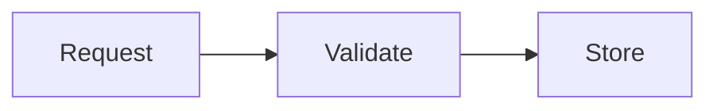

# Request processing

This is an exploratory XMarkdown source example. It illustrates the proposed input, not an implemented parser or measured efficiency result. The `x-chart` schema and directive vocabulary are not finalized. The sample values are fictional.

The API validates each request before storing it.

:::note[Trust boundary]
The renderer receives content and data, not author programs.
:::



The following fictional report illustrates a bar-chart block:

```x-chart
{
  "type": "bar",
  "title": "Requests per day",
  "x": "day",
  "y": "requests",
  "data": [
    {"day": "Mon", "requests": 24},
    {"day": "Tue", "requests": 31}
  ],
  "description": "Requests increased from 24 on Monday to 31 on Tuesday."
}
```

A future renderer would supply axes, diagram layout, a theme, and responsive sizing. In an ordinary Markdown renderer, the graphics specifications remain code blocks.
